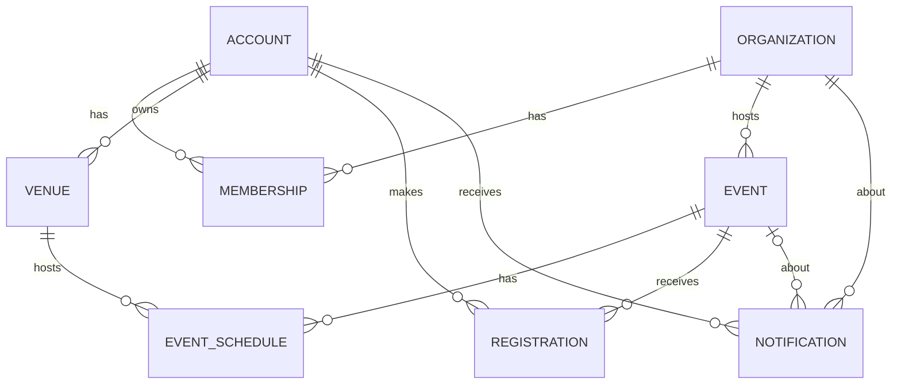

# UniSync Database Documentation

## 1. Overview

| Item | Value |
|---|---|
| Database name | `grp10_unisyncdb` |
| DBMS | PostgreSQL 18.6 |
| Schema | `public` |
| Tables | 8 |
| Schema script | `db/init.sql` |
| Sample data script | `db/seed.sql` |

`db/init.sql` runs inside one transaction. It **drops and recreates** all eight tables, so running it on an existing database erases its data. Run `init.sql` first, then `seed.sql`.

```bash
psql -U postgres -d grp10_unisyncdb -f db/init.sql
psql -U postgres -d grp10_unisyncdb -f db/seed.sql
```

## 2. Entity Relationship Diagram

Text version (renders on GitHub):



## 3. Tables

### 3.1 ACCOUNT

User accounts. Also used for venue provider accounts (see `VENUE`).

| Column | Type | Null | Default | Key | Description |
|---|---|---|---|---|---|
| `account_id` | SERIAL | No | auto | PK | Account identifier |
| `account_name` | VARCHAR(150) | No | | | Display name |
| `email` | VARCHAR(255) | No | | UNIQUE | Login email |
| `password_hash` | TEXT | No | | | Hashed password |
| `avatar_url` | TEXT | Yes | | | Profile image path |
| `account_status` | VARCHAR(30) | No | `'active'` | | Account state |

Constraints: `chk_account_status` allows `active`, `disabled`, `deleted`.

### 3.2 ORGANIZATION

University organizations.

| Column | Type | Null | Default | Key | Description |
|---|---|---|---|---|---|
| `organization_id` | SERIAL | No | auto | PK | Organization identifier |
| `organization_name` | VARCHAR(150) | No | | | Name |
| `university_name` | VARCHAR(150) | No | | | University it belongs to |
| `description` | TEXT | Yes | | | About the organization |
| `avatar_url` | TEXT | Yes | | | Logo path |
| `banner_url` | TEXT | Yes | | | Banner image path |
| `status` | VARCHAR(30) | No | `'active'` | | Organization state |

Constraints: `chk_organization_status` allows `active`, `inactive`, `deleted`.

### 3.3 MEMBERSHIP

Links accounts to organizations and stores the organization-level role.

| Column | Type | Null | Default | Key | Description |
|---|---|---|---|---|---|
| `membership_id` | SERIAL | No | auto | PK | Membership identifier |
| `account_id` | INTEGER | No | | FK → ACCOUNT | Member |
| `organization_id` | INTEGER | No | | FK → ORGANIZATION | Organization |
| `role` | VARCHAR(20) | No | `'Member'` | | Role in the organization |
| `membership_date` | DATE | No | `CURRENT_DATE` | | Date joined |
| `status` | VARCHAR(30) | No | `'active'` | | Membership state |

Constraints:
- `fk_membership_account`: ON DELETE CASCADE
- `fk_membership_organization`: ON DELETE CASCADE
- `uq_account_organization`: UNIQUE (`account_id`, `organization_id`)
- `chk_membership_role`: `Admin`, `Manager`, `Member`
- `chk_membership_status`: `active`, `inactive`, `deleted`

### 3.4 EVENT

Events created by organizations.

| Column | Type | Null | Default | Key | Description |
|---|---|---|---|---|---|
| `event_id` | SERIAL | No | auto | PK | Event identifier |
| `organization_id` | INTEGER | No | | FK → ORGANIZATION | Hosting organization |
| `event_name` | VARCHAR(200) | No | | | Event title |
| `description` | TEXT | Yes | | | Details |
| `event_image` | TEXT | Yes | | | Uploaded image path |
| `status` | VARCHAR(20) | No | `'pending'` | | Event state |

Constraints:
- `fk_event_organization`: ON DELETE CASCADE
- `chk_event_status`: `pending`, `confirmed`, `cancelled`, `completed`, `deleted`

### 3.5 VENUE

Event locations with map coordinates. Each venue belongs to a provider account.

| Column | Type | Null | Default | Key | Description |
|---|---|---|---|---|---|
| `venue_id` | SERIAL | No | auto | PK | Venue identifier |
| `account_id` | INTEGER | No | | FK → ACCOUNT | Provider account that owns the venue |
| `venue_name` | VARCHAR(150) | No | | | Venue name |
| `location` | TEXT | No | | | Address |
| `capacity` | INT | Yes | | | Maximum attendees |
| `latitude` | DECIMAL(10,7) | Yes | | | Map latitude |
| `longitude` | DECIMAL(10,7) | Yes | | | Map longitude |
| `status` | VARCHAR(30) | No | `'active'` | | Venue state |

Constraints:
- `fk_venue_account`: ON DELETE RESTRICT
- `uq_provider_venue_name`: UNIQUE (`account_id`, `venue_name`)
- `chk_venue_capacity`: capacity is NULL or greater than 0
- `chk_venue_latitude`: NULL or between -90 and 90
- `chk_venue_longitude`: NULL or between -180 and 180
- `chk_venue_coordinates`: latitude and longitude must both be set or both be NULL
- `chk_venue_status`: `active`, `inactive`, `deleted`

### 3.6 EVENT_SCHEDULE

Date, time, and venue for each event. Also serves as the venue application/request record.

| Column | Type | Null | Default | Key | Description |
|---|---|---|---|---|---|
| `schedule_id` | SERIAL | No | auto | PK | Schedule identifier |
| `event_id` | INTEGER | No | | FK → EVENT | Event |
| `venue_id` | INTEGER | No | | FK → VENUE | Venue |
| `event_date` | DATE | No | | | Date of the schedule |
| `start_time` | TIME | No | | | Start time |
| `end_time` | TIME | No | | | End time |
| `status` | VARCHAR(30) | No | `'pending'` | | Schedule state |

Constraints:
- `fk_schedule_event`: ON DELETE CASCADE
- `fk_schedule_venue`: ON DELETE RESTRICT
- `chk_schedule_time`: `end_time > start_time`
- `chk_schedule_status`: `pending`, `confirmed`, `rejected`, `cancelled`, `completed`

### 3.7 REGISTRATION

Account-to-event registrations.

| Column | Type | Null | Default | Key | Description |
|---|---|---|---|---|---|
| `registration_id` | SERIAL | No | auto | PK | Registration identifier |
| `account_id` | INTEGER | No | | FK → ACCOUNT | Registrant |
| `event_id` | INTEGER | No | | FK → EVENT | Event |
| `registration_date` | TIMESTAMP | No | `CURRENT_TIMESTAMP` | | When registered |
| `status` | VARCHAR(30) | No | `'active'` | | Registration state |

Constraints:
- `fk_registration_account`: ON DELETE CASCADE
- `fk_registration_event`: ON DELETE CASCADE
- `uq_account_event`: UNIQUE (`account_id`, `event_id`)
- `chk_registration_status`: `active`, `cancelled`, `deleted`

### 3.8 NOTIFICATION

Exists in the schema but is not used by the application. Left empty in the seed data.

| Column | Type | Null | Default | Key | Description |
|---|---|---|---|---|---|
| `notification_id` | SERIAL | No | auto | PK | Notification identifier |
| `account_id` | INTEGER | No | | FK → ACCOUNT | Recipient |
| `organization_id` | INTEGER | No | | FK → ORGANIZATION | Related organization |
| `event_id` | INTEGER | Yes | | FK → EVENT | Related event, if any |
| `notification_message` | TEXT | No | | | Message text |
| `is_read` | BOOLEAN | No | `FALSE` | | Read flag |
| `created_at` | TIMESTAMP | No | `CURRENT_TIMESTAMP` | | Creation time |
| `status` | VARCHAR(30) | No | `'active'` | | Notification state |

Constraints:
- `fk_notification_account`: ON DELETE CASCADE
- `fk_notification_organization`: ON DELETE CASCADE
- `fk_notification_event`: ON DELETE SET NULL
- `chk_notification_status`: `active`, `deleted`

## 4. Relationships

| Parent | Child | Cardinality | On delete |
|---|---|---|---|
| ACCOUNT | MEMBERSHIP | one-to-many | CASCADE |
| ORGANIZATION | MEMBERSHIP | one-to-many | CASCADE |
| ORGANIZATION | EVENT | one-to-many | CASCADE |
| EVENT | EVENT_SCHEDULE | one-to-many | CASCADE |
| VENUE | EVENT_SCHEDULE | one-to-many | RESTRICT |
| ACCOUNT | VENUE | one-to-many | RESTRICT |
| ACCOUNT | REGISTRATION | one-to-many | CASCADE |
| EVENT | REGISTRATION | one-to-many | CASCADE |
| ACCOUNT | NOTIFICATION | one-to-many | CASCADE |
| ORGANIZATION | NOTIFICATION | one-to-many | CASCADE |
| EVENT | NOTIFICATION | one-to-many (optional) | SET NULL |

`ACCOUNT` and `ORGANIZATION` are linked many-to-many through `MEMBERSHIP`. `ACCOUNT` and `EVENT` are linked many-to-many through `REGISTRATION`.

## 5. Business Rules

- An account can hold only one membership per organization (`uq_account_organization`).
- An account can register for an event only once (`uq_account_event`).
- A schedule's end time must be later than its start time (`chk_schedule_time`).
- A venue must have both coordinates or neither, within valid latitude and longitude ranges.
- A provider cannot have two venues with the same name (`uq_provider_venue_name`).
- A venue cannot be hard-deleted while schedules or its owner account depend on it (RESTRICT).
- The application uses **soft deletes**: rows are marked through their `status` column (`deleted`, `inactive`, `cancelled`) instead of being removed. Deleting an organization marks its events as deleted.
- Organization roles (`Admin`, `Manager`, `Member`) are stored per membership, so one account can hold different roles in different organizations.

## 6. Indexes

| Index | Table | Columns |
|---|---|---|
| `idx_membership_organization` | MEMBERSHIP | `organization_id` |
| `idx_membership_account` | MEMBERSHIP | `account_id` |
| `idx_event_organization` | EVENT | `organization_id` |
| `idx_venue_account` | VENUE | `account_id` |
| `idx_schedule_date_venue` | EVENT_SCHEDULE | `event_date`, `venue_id` |
| `idx_schedule_status` | EVENT_SCHEDULE | `status` |
| `idx_registration_event` | REGISTRATION | `event_id` |
| `idx_registration_account` | REGISTRATION | `account_id` |
| `idx_notification_account_created` | NOTIFICATION | `account_id`, `created_at` DESC |

Primary keys and UNIQUE constraints also create their own indexes automatically.

## 7. Other Database Objects

Views, triggers, functions, and custom roles: none in `init.sql`. Intended database roles are described in [`database-roles.md`](database-roles.md).

## 8. Sample Data

`db/seed.sql` loads 100+ accounts, 30 organizations, 50 events, and venues with real addresses and map coordinates. `NOTIFICATION` is intentionally empty. Seeded passwords are hashes of sample passwords for testing only.